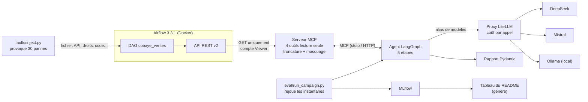

# Agent de diagnostic de pipelines Airflow (MCP · LangGraph · LiteLLM · MLflow)

Un agent IA qui repère une tâche Airflow en échec, en diagnostique la cause à partir des
journaux, propose une correction et décide s'il faut prévenir un humain. Il ne voit Airflow
**qu'à travers un serveur MCP en lecture seule**. Il appelle les modèles **via une passerelle
LiteLLM**, et ses performances sont **mesurées dans MLflow** sur 30 pannes réelles et étiquetées.



## Résultats

Les chiffres ci-dessous sont **générés depuis MLflow** par `eval/make_results_table.py`, à partir
des campagnes réellement exécutées (les campagnes au faux modèle de test sont refusées).
Aucun chiffre n'est écrit à la main.

<!-- RESULTATS:DEBUT -->
| Stratégie | Configuration | Exactitude | Justesse diag. (juge) | Escalades correctes | Coût / diagnostic | Durée moy. | Fuites | n | Run MLflow |
|---|---|---|---|---|---|---|---|---|---|
| gros | gros-deepseek-pro | 97 % [83–99] | 92 % | 93 % | 0.01870 $ | 46.7 s | 0 | 30 | `a2cf5e1d` |
| petit | petit-deepseek-flash | 97 % [83–99] | 95 % | 97 % | 0.00330 $ | 18.2 s | 0 | 30 | `c1a2bab4` |
| routage | routage-deepseek-flash-deepseek-pro | 97 % [83–99] | 95 % | 90 % | 0.00390 $ | 21.7 s | 0 | 30 | `097b85c2` |

_Vérification manuelle du juge : pas encore faite (`make verif-juge`)._

Exactitude : entre crochets, intervalle de confiance à 95 % (Wilson). Avec 30 pannes, deux configurations dont les intervalles se chevauchent largement ne sont pas départagées.

_Tableau généré depuis MLflow le 2026-11-11 01:32 UTC par `eval/make_results_table.py` ; ne pas modifier à la main._
<!-- RESULTATS:FIN -->

Définitions :
- **Exactitude** : part des 30 pannes classées dans la bonne catégorie (un plantage de l'agent compte comme une erreur).
- **Justesse diag. (juge)** : note moyenne du LLM juge (0, 1 ou 2, ramenée en %) avec la grille `eval/grille_juge.md`,
  vérifiée à la main sur un échantillon (accord et kappa pondéré publiés sous le tableau).
- **Escalades correctes** : part des pannes où la décision « prévenir un humain » est celle attendue.
- **Coût / diagnostic** : coût calculé par LiteLLM, juge exclu. **Fuites** : secrets canaris retrouvés dans une requête à un modèle (objectif : 0).

## Démarrage

Prérequis : Docker avec Compose v2, Python ≥ 3.11, et au moins une clé d'API (DeepSeek et/ou Mistral).
Mémoire : environ 4 Go pour la pile sans modèle local (`make up`), environ 10 Go avec (`make up-local`).
Peu de RAM ? Le dépôt contient une configuration **GitHub Codespaces** (`.devcontainer/`) : une machine
de 4 cœurs et 16 Go, dans le navigateur, qui fait tout tourner, Docker compris.

```bash
make env        # crée .env : y mettre DEEPSEEK_API_KEY / MISTRAL_API_KEY
make venv       # environnement Python local (.venv)
make up         # Airflow, entrepôt, API simulée, serveur MCP, LiteLLM, MLflow (make up-local : + Ollama)
make test       # tests sans réseau (vrais instantanés Airflow, faux modèles)
make pannes     # provoque les 30 pannes et capture les instantanés (~45 min)
make eval       # campagne complète (7 configurations) -> MLflow -> tableau ci-dessus
```

Interfaces : Airflow http://localhost:8080 (airflow / airflow), MLflow http://localhost:5000,
serveur MCP http://localhost:8765/mcp (`make inspecteur` ouvre l'inspecteur MCP officiel).

Démo (vidéo) : `make demo` provoque une panne (par défaut U01, `PANNE=P03 make demo` pour une autre),
la laisse en place, puis lance l'agent **en direct** sur Airflow via le serveur MCP. `python -m faults.inject --reset` répare.
Le déroulé de la vidéo est décrit dans [docs/DEMO.md](docs/DEMO.md).

## Les briques

| Brique | Où | En bref |
|---|---|---|
| Pipeline cobaye | `airflow/dags/cobaye_ventes.py` | 5 tâches : fichier CSV, API de taux, conversion, entrepôt Postgres, rapport |
| Pannes | `faults/scenarios.yaml`, `faults/inject.py` | 30 pannes (5 par catégorie) provoquées **de l'extérieur** ; vérité terrain : catégorie, cause, tâche, escalade |
| Serveur MCP | `mcp_server/` | `list_failed_runs`, `get_task_logs`, `get_dag_source`, `get_task_history` ; lecture seule, journaux tronqués avec numéros d'origine, secrets masqués |
| Agent | `agent/graph.py` | LangGraph : collecter → classer → (routage) → diagnostiquer → corriger → escalader |
| Rapport | `agent/schemas.py` | Pydantic ; relance du modèle si la sortie est invalide ; citations et diff vérifiés |
| Passerelle | `litellm/config.yaml` | alias → DeepSeek, Mistral, Ollama ; coût de chaque appel |
| Évaluation | `eval/` | rejeu des instantanés, métriques, juge, vérification humaine, MLflow |
| CI | `.github/workflows/eval.yml` | tests à chaque commit + évaluation courte qui échoue si l'exactitude baisse |

Les choix sont expliqués brique par brique dans [docs/GUIDE.md](docs/GUIDE.md), et chaque décision
(avec ses alternatives) dans [DECISIONS.md](DECISIONS.md).

## Le jeu de pannes

| Catégorie | Pannes | Exemples |
|---|---|---|
| donnée manquante | D01–D05 | fichier non déposé, fichier vide, API sans aucun taux |
| schéma modifié | S01–S05 | colonne CSV renommée, format de date, champ d'API renommé, colonne de la table cible renommée |
| délai dépassé | T01–T05 | API lente, verrou sur la table, timeout abaissé, réponse au goutte-à-goutte, lenteur répétée 3 fois |
| erreur de code | C01–C05 | variable mal nommée, `int()` sur des décimaux, mauvaise clé, SQL à 4 paramètres pour 5 |
| dépendance indisponible | U01–U05 | API en 503, service arrêté, entrepôt arrêté, base fermée, connexion coupée |
| droits insuffisants | P01–P05 | clé refusée (401), 403, `REVOKE INSERT`, dossier en lecture seule, rôle `NOLOGIN` |

17 pannes sur 30 doivent être escaladées (politique dans `agent/policy.py`, la même pour la vérité terrain et pour l'agent).

Les instantanés versionnés dans `faults/snapshots/` ont été capturés sur un vrai Airflow 3.3.1 en **mode local
sans Docker** pendant le développement (`faults/manifest.json`, champ `environnement`). Dans ce mode, P04 est
invalide : Airflow y tournait en root, qui ignore les droits du dossier. L'injecteur l'a détecté et l'a marqué
comme tel. `make pannes` recapture les 30 pannes dans la pile Docker, où les tâches ne tournent pas en root.

## Évaluation : comment lire les chiffres

- Toutes les configurations rejouent **les mêmes instantanés** : mêmes journaux, même source, même historique.
- 30 pannes, c'est peu : l'exactitude est donnée avec son **intervalle de confiance à 95 %** (Wilson).
- Le juge est un LLM : ses notes sont vérifiées à l'aveugle sur un échantillon (`make verif-juge`, puis `make accord-juge`).
- Le coût est l'estimation LiteLLM au tarif plein. Le modèle local est compté à 0 $ (le matériel n'est pas compté).

## Structure

```
airflow/            DAG cobaye, image et initialisation Airflow
services/           API fournisseur simulée, entrepôt Postgres (schéma, remise à zéro)
mcp_server/         serveur MCP : client Airflow (live / enregistrement / rejeu), journaux, masquage
agent/              graphe LangGraph, prompts, schémas, validations, escalade, CLI
faults/             catalogue des 30 pannes, injecteur, instantanés capturés, manifeste
eval/               campagnes, métriques, fuites, juge, vérification manuelle, tableau, CI
litellm/ mlflow/    passerelle de modèles et serveur de suivi
tests/              tests unitaires et de bout en bout (vrais instantanés, faux modèles)
docs/               guide des briques, déroulé de la démo
```
